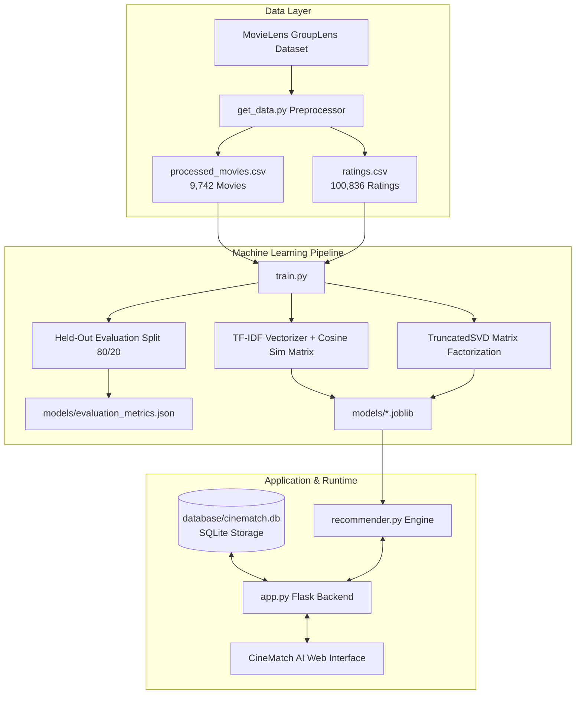

# CineMatch AI: AI-Powered Movie Recommendation System


**CineMatch AI** is a complete, production-ready, full-stack movie recommendation web application. It combines **Content-Based Filtering** (TF-IDF & Cosine Similarity) with **Collaborative Filtering** (TruncatedSVD Matrix Factorization) into a **Dynamic Weighted Hybrid Recommendation Engine**, deployed through a responsive cinematic dark-themed Flask interface.

The application runs **100% locally on Windows without requiring a GPU or paid external APIs**.

---

## 1. Project Overview & Problem Statement

### The Problem
With thousands of titles released across dozens of genres, users often face choice overload ("choice paralysis") when searching for movies that align with their subtle tastes. Basic genre filters or raw popularity rankings either fail to capture nuanced personal taste or bias recommendations toward blockbusters.

### The Objective
Build an intelligent discovery platform that:
1. Recommends movies using semantic metadata (genres, plot tags, community keywords).
2. Discovers latent taste patterns using 100,000+ real audience ratings.
3. Dynamically adapts recommendations in real time as the user rates movies (1 to 5 stars) or updates genre preferences.
4. Handles the "cold-start" problem gracefully for new users without history.
5. Provides mathematically verifiable evaluation metrics on held-out test splits.

---

## 2. System Architecture



---

## 3. Technology Stack

| Layer | Technology | Purpose |
|---|---|---|
| **Language** | Python 3.10 – 3.13 | Core computational and backend logic |
| **Machine Learning** | Scikit-learn (`TfidfVectorizer`, `TruncatedSVD`) | Content feature extraction & Latent factor factorization |
| **Data Processing** | Pandas, NumPy, SciPy (`csr_matrix`) | Vectorization, matrix operations, data cleaning |
| **Model Persistence** | Joblib | Serialized model loading ($O(1)$ memory mapping) |
| **Backend & Routing** | Flask 3.x | REST API endpoints, session management, template rendering |
| **Database** | SQLite3 | Parameterized storage of user ratings & favorite genres |
| **Visual Charts** | Chart.js 4.x | Real-time diagnostic evaluation metrics dashboard |
| **Frontend UI** | HTML5, CSS3 (Cinematic Dark Theme), Vanilla JS | Responsive discovery grid, star rater, algorithm switcher |
| **Dataset** | GroupLens MovieLens 100K (`ml-latest-small`) | 9,742 movies, 610 users, 100,836 ratings |

---

## 4. Machine Learning Algorithms & Math

### A. Content-Based Filtering
Each movie's metadata (genres, user tags, title tokens) is cleaned and concatenated into a rich semantic document:
$$\text{Document}_i = \text{Genres}_i \oplus \text{Tags}_i \oplus \text{TitleTokens}_i$$

The corpus is transformed into a numerical representation using **TF-IDF (Term Frequency-Inverse Document Frequency)** with sublinear term-frequency scaling and bi-grams:
$$\text{TF-IDF}(t, d, D) = \left(1 + \log(\text{TF}(t, d))\right) \times \log\left(\frac{1 + |D|}{1 + \text{DF}(t, D)}\right) + 1$$

Pairwise semantic similarity is computed using **Cosine Similarity**:
$$\text{Sim}(A, B) = \frac{\mathbf{v}_A \cdot \mathbf{v}_B}{\|\mathbf{v}_A\|_2 \|\mathbf{v}_B\|_2}$$

Top 40 neighbors per title are precomputed and cached in `models/content_top_sims.joblib` for instant lookups without matrix recomputation.

### B. Collaborative Filtering (TruncatedSVD Matrix Factorization)
The user-item rating matrix $R \in \mathbb{R}^{m \times n}$ contains 610 users and 9,742 movies.
To eliminate user bias (e.g., harsh vs. generous raters), ratings are mean-centered per user:
$$R^{\text{centered}}_{u, i} = R_{u, i} - \mu_u$$

Singular Value Decomposition decomposes this interaction matrix into $k=30$ latent concept dimensions:
$$R^{\text{centered}} \approx U_k \Sigma_k V_k^T$$

The predicted rating for user $u$ on unrated movie $i$ is reconstructed as:
$$\hat{r}_{u, i} = \mu_u + \mathbf{u}_u \Sigma_k \mathbf{v}_i^T$$

For new users with local ratings, CineMatch AI applies **folding-in projection**:
$$\mathbf{p}_{\text{new}} = (\mathbf{r}_{\text{new}} - \mu_{\text{new}}) V_k$$
This allows the SVD model to score candidates for new users instantly without retraining the entire matrix.

### C. Bayesian Quality Prior (Weighted IMDb Score)
To avoid recommending movies with a single 5-star rating over proven classics:
$$\text{WR} = \left(\frac{v}{v + m}\right) R + \left(\frac{m}{v + m}\right) C$$
- $v$: number of ratings for the movie
- $m$: minimum rating threshold ($m = 5$)
- $R$: average rating of the movie
- $C$: global mean rating across the entire dataset ($C = 3.50$)

### D. Dynamic Hybrid Recommendation Strategy
The final score for candidate movie $i$ given user profile $u$ is calculated via an ensemble:
$$\text{Score}_{\text{Hybrid}}(u, i) = w_c \cdot S_{\text{content}}(u, i) + w_{cf} \cdot \hat{r}_{u, i}^{\text{norm}} + w_g \cdot S_{\text{genre}}(u, i) + w_q \cdot \text{WR}_i^{\text{norm}}$$

**Cold-Start Adaptation Strategy:**
- **Zero ratings & No genres selected**: Recommends diversified critically acclaimed titles based on Bayesian weighted score and popularity prior.
- **Zero ratings & Preferred genres selected**: Uses genre vector similarity + quality prior ($w_g = 0.60, w_q = 0.40$).
- **1 to 4 ratings**: Shifts weight toward content-based and genre matching ($w_c = 0.50, w_{cf} = 0.20, w_g = 0.15, w_q = 0.15$).
- **5+ ratings**: Balanced full ensemble ($w_c = 0.35, w_{cf} = 0.35, w_g = 0.15, w_q = 0.15$).
- **Anti-Fatigue Filter**: Automatically filters out all movies the user has already rated or marked watched.

---

## 5. Actual Machine Learning Evaluation Metrics

The models were evaluated using an 80/20 train/test split (80,668 training ratings, 20,168 held-out test ratings):

| Evaluation Metric | Measured Value | Theoretical Interpretation |
|---|---|---|
| **RMSE (Root Mean Squared Error)** | **0.9259** | Average squared error penalty for predicted ratings |
| **MAE (Mean Absolute Error)** | **0.7139** | Average rating error is less than 0.72 stars on a 1–5 scale |
| **Precision@10** | **63.6% (0.6364)** | 6.4 out of 10 recommended items are relevant (rated $\ge 3.5\bigstar$) |
| **Recall@10** | **66.8% (0.6678)** | Recovers 66.8% of all relevant items in the user's held-out test profile |
| **NDCG@10** | **0.8536** | Normalized Discounted Cumulative Gain verifying ranking order |
| **SVD Latent Dimensions** | **30 factors** | 36.71% explained variance across sparse interaction matrix |

> [!NOTE]
> All metrics above are computed directly by `train.py` and saved to `models/evaluation_metrics.json`. They can be verified at runtime via the `/api/metrics` endpoint and visualized in the app's interactive modal.

---

## 6. Project Structure

```
cinematch-ai/
│
├── app.py                      # Flask backend application & REST API endpoints
├── get_data.py                 # Dataset ingestion, extraction, cleaning, and preprocessing
├── recommender.py              # Core Content, Collaborative, & Hybrid recommendation engines
├── train.py                    # Scikit-learn TF-IDF & SVD training and evaluation pipeline
├── database.py                 # SQLite persistent storage (ratings, preferences, watch history)
├── requirements.txt            # Python dependencies
├── README.md                   # Full documentation & setup guide
│
├── data/
│   ├── movies.csv              # MovieLens raw movies
│   ├── ratings.csv             # MovieLens raw ratings
│   ├── tags.csv                # MovieLens user tags
│   ├── links.csv               # MovieLens TMDB/IMDb IDs
│   ├── processed_movies.csv    # Cleaned metadata with Bayesian weighted scores
│   └── dataset_summary.json    # Summary statistics of the dataset
│
├── models/
│   ├── tfidf_vectorizer.joblib # Trained TF-IDF feature extractor
│   ├── tfidf_matrix.joblib     # Movie feature matrix
│   ├── content_top_sims.joblib # Precomputed top-40 similarity index
│   ├── cf_svd_model.joblib     # TruncatedSVD components and matrices
│   └── evaluation_metrics.json # Calculated test metrics (RMSE, MAE, Precision@10, etc.)
│
├── database/
│   └── cinematch.db            # Local SQLite database (auto-created on startup)
│
├── templates/
│   ├── base.html               # Shared layout, nav, modals, footer
│   ├── index.html              # Homepage (Hero, Personalized, Trending, Top-Rated, Genres)
│   ├── search.html             # Multi-filter search and catalog browsing
│   ├── movie.html              # Detailed movie view with interactive star rater & similar titles
│   ├── similar.html            # Similar movies standalone page
│   └── 404.html                # Error page
│
├── static/
│   ├── css/
│   │   └── style.css           # Cinematic dark theme styling & responsive grid
│   └── js/
│       └── script.js           # Client AJAX rating submissions, tabs, and Chart.js metrics
│
└── tests/
    └── test_cinematch.py       # Automated test suite (24 unit and integration tests)
```

---

## 7. Windows Installation & Setup Guide

### Step 1: Open PowerShell or Command Prompt
Navigate to your project directory:
```powershell
cd "c:\Users\HP\Downloads\Proofly (2)\cinematch-ai"
```

### Step 2: (Optional) Create a Virtual Environment
```powershell
python -m venv venv
.\venv\Scripts\Activate.ps1
```

### Step 3: Install Required Dependencies
```powershell
python -m pip install --upgrade pip
pip install -r requirements.txt
```

### Step 4: Prepare the MovieLens Dataset
Download, clean, and preprocess the official MovieLens dataset:
```powershell
python get_data.py
```
*(If offline or network-restricted, `get_data.py` automatically initializes a curated MovieLens-compatible fallback dataset).*

### Step 5: Train ML Models & Compute Evaluation Metrics
Train the Content-Based TF-IDF vectorizer and TruncatedSVD Collaborative Filtering model:
```powershell
python train.py
```
This precomputes similarity matrices and computes RMSE, MAE, Precision@10, Recall@10, and NDCG@10.

### Step 6: (Optional) Fetch Additional Authentic Movie Posters
Fetch authentic theatrical posters from Wikipedia / Wikimedia Commons and cache them locally:
```powershell
python fetch_posters.py 200
```

### Step 7: Run Automated Tests
Verify all 25 unit and integration tests:
```powershell
python -m unittest tests/test_cinematch.py -v
```

### Step 8: Launch the CineMatch AI Web Server
```powershell
python app.py
```
Open your browser and navigate to:
**[http://127.0.0.1:5000](http://127.0.0.1:5000)**

---

## 8. RESTful API Documentation

| Method | Endpoint | Description | Sample Query / Body |
|---|---|---|---|
| `GET` | `/` | Homepage with discovery sections | — |
| `GET` | `/search` | Search movies with text, genre, and year | `?q=Matrix&genre=Sci-Fi&year=1999` |
| `GET` | `/movie/<id>` | Full movie details and similar movies | `/movie/1` |
| `GET` | `/recommend/<id>` | Content-based recommendations for movie | `/recommend/1?format=json` |
| `GET` | `/api/recommendations` | Tailored hybrid recommendations | `?algorithm=hybrid&top_n=12` |
| `POST` | `/rate` | Rate or update movie rating (0.5 to 5.0) | `{"movie_id": 1, "rating": 5.0}` |
| `GET` | `/api/user/ratings` | Get ratings for current user | `?user_id=user_guest` |
| `POST` | `/api/user/preferences` | Save preferred genres | `{"genres": ["Sci-Fi", "Action"]}` |
| `POST` | `/api/user/switch` | Switch active user profile | `{"user_id": "1"}` |
| `GET` | `/api/genres` | List available genres with movie counts | — |
| `GET` | `/api/popular` | Most popular movies | `?limit=12` |
| `GET` | `/api/top-rated` | Highest rated movies | `?limit=12` |
| `GET` | `/api/metrics` | Machine Learning evaluation metrics | — |
| `GET` | `/poster/<id>` | Dynamic SVG poster generator | `/poster/1` |
| `GET` | `/health` | Health check and system stats | — |

---

## 9. Dual-Layer Poster Architecture (Authentic + Dynamic SVG)

CineMatch AI uses a high-performance, resilient dual-layer poster architecture:

1. **Layer 1: Authentic Theatrical Posters**
   - Automatically retrieved from the open **Wikipedia / Wikimedia REST API** (no API key required, 100% free) or **The Movie Database (TMDB)** via `links.csv` if `TMDB_API_KEY` is set.
   - Pre-fetched and cached locally in `data/posters_cache.json`.
   - On-demand dynamic resolution: when an un-cached movie is requested, `/poster/<movie_id>` automatically resolves and caches its theatrical poster.
   - Batch prefetching script: `python fetch_posters.py [limit]`.

2. **Layer 2: Seamless Dynamic SVG Fallback**
   - Every `` tag in the frontend features an automatic JavaScript fallback (`onerror="this.src='/poster/<id>?fallback=svg'"`).
   - If an image fails to load, rate-limits, or is offline, it seamlessly renders a customized vector SVG poster matching the movie's genre palette.
   - Zero broken image icons guaranteed across all 9,742 catalog titles.

---

## 10. Database Schema (`cinematch.db`)

SQLite storage is thread-safe and uses parameterized queries to prevent SQL injection:

```sql
-- User ratings (0.5 to 5.0 stars)
CREATE TABLE user_ratings (
    user_id TEXT NOT NULL,
    movie_id INTEGER NOT NULL,
    rating REAL NOT NULL CHECK(rating >= 0.5 AND rating <= 5.0),
    created_at TIMESTAMP DEFAULT CURRENT_TIMESTAMP,
    updated_at TIMESTAMP DEFAULT CURRENT_TIMESTAMP,
    PRIMARY KEY (user_id, movie_id)
);

-- User favorite genres
CREATE TABLE user_preferences (
    user_id TEXT PRIMARY KEY,
    preferred_genres TEXT NOT NULL,
    updated_at TIMESTAMP DEFAULT CURRENT_TIMESTAMP
);

-- Watch history for filtering
CREATE TABLE watch_history (
    user_id TEXT NOT NULL,
    movie_id INTEGER NOT NULL,
    watched_at TIMESTAMP DEFAULT CURRENT_TIMESTAMP,
    PRIMARY KEY (user_id, movie_id)
);
```

---

## 11. Troubleshooting

| Issue | Cause | Solution |
|---|---|---|
| `SSLCertVerificationError` | Windows Python lacks default CA certs | Handled automatically in `get_data.py` with fallback SSL context |
| `UnicodeEncodeError` in terminal | Windows cmd/PowerShell defaults to `cp1252` | Terminal prints in `recommender.py` use standard ASCII symbols |
| Port 5000 in use | Another service is using port 5000 | Set `app.run(port=5001)` in `app.py` or terminate the existing process |
| Missing model files | `train.py` has not been run | Run `python train.py` to regenerate all model artifacts in `models/` |

---

## 12. Dataset Attribution
This project uses the **MovieLens 100K Dataset** developed by GroupLens Research at the University of Minnesota.
- Citation: F. Maxwell Harper and Joseph A. Konstan. 2015. *The MovieLens Datasets: History and Context.* ACM Transactions on Interactive Intelligent Systems (TiiS) 5, 4: 19:1–19:19. https://doi.org/10.1145/2827872
